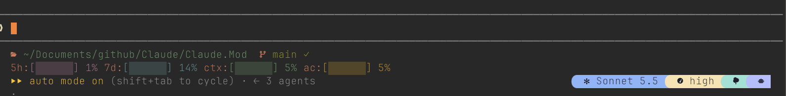

# Claude.Mods

[](README.md)
[](README.ja.md)

Mods (plugins) for [Claude Code](https://claude.com/claude-code) that reshape its terminal UI. Each mod installs on its own.

| Mod | What it does |
| --- | --- |
| [statusbar-buttons](statusbar-buttons/README.md) | Model, effort, worktree and subagent buttons at the right end of the hint line under the prompt, in joined powerline blocks. Pairs with the [statusline](statusbar-buttons/statusline/README.md) command, which draws the path, git, PR and usage gauges in Claude Code's own status line |
| [filepicker](filepicker/README.md) | A file and folder browser that opens while you type an `@` mention, with Quick Look preview |
| [peek](peek/README.md) | Colors your prompts and Claude's messages with a gutter, folds each tool call in the transcript to one line (results hidden), and shows the conversation in a pane a page at a time: under your prompt, the thinking and tool calls between two of Claude's messages, each call's input and result shown or folded per call, the other pages a press away. The transcript has four levels: nothing folded, tool calls folded to one line, without the tool lines, or your prompts and Claude's answers alone |

See each mod's README for its features and requirements.

| statusbar-buttons |
| --- |
|  |

| filepicker | peek |
| --- | --- |
|  |  |

## Install

Add this repository as a marketplace, then install the mods you want:

```sh
claude plugin marketplace add tkhashi/Claude.Mods
claude plugin install statusbar-buttons@local-mods
claude plugin install filepicker@local-mods
claude plugin install peek@local-mods
```

Start a new session to load them. To update later:

```sh
claude plugin marketplace update local-mods
claude plugin update statusbar-buttons@local-mods
claude plugin update filepicker@local-mods
claude plugin update peek@local-mods
```

All mods need Claude Code with mod (plugin hooks) support and a [Nerd Font](https://www.nerdfonts.com/) in your terminal.

## Development

The source of truth is this repository. To work on it locally, point the `local-mods` marketplace at your clone (for example by symlinking `~/.claude/local-mods` to it), then:

```sh
cd statusbar-buttons   # or filepicker, peek
claude plugin validate .
claude plugin test .
```

`.claude-plugin/types/` holds generated type definitions and is not committed.

## License

[MIT](LICENSE) © tkhashi

### Third-party notices

- `filepicker/hooks/devicons.ts` is generated from [nvim-web-devicons](https://github.com/nvim-tree/nvim-web-devicons), MIT License, Copyright (c) 2023 nvim-tree. See [`filepicker/LICENSE.nvim-web-devicons`](filepicker/LICENSE.nvim-web-devicons).
- The color palette follows [Catppuccin](https://github.com/catppuccin/catppuccin) Mocha (MIT).
- Icons are drawn from your installed [Nerd Font](https://www.nerdfonts.com/); no font files are distributed here.
