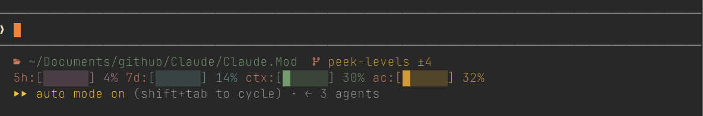

# statusline

[](README.md)
[](README.ja.md)

Claude Code 本体の[ステータスライン](https://code.claude.com/docs/en/statusline)に、[statusbar](../../statusbar/README.ja.md) mod の表示専用の部分を、昔の `statusline-command.sh` と同じ見た目(オレンジのラベルに値を続ける形)で、作業ディレクトリ・git・PR も使用量インジケータも出すコマンドです。パスとブランチはラベルの代わりに Nerd Font のアイコンで出します。押せる部分(model・effort・worktree・サブエージェント)は [statusbar-buttons](../README.ja.md) mod が受け持ちます。



## 表示するもの

- 作業ディレクトリ、ブランチ(push 待ち `↑`・pull 待ち `↓`・未コミット `±`、きれいなら ✓)、PR 番号(リンク。色はレビュー状態)。` ~/work   main ±3  pr:#9` のように出します
- 5時間・7日間の上限、コンテキスト、auto-compact の使用量インジケータを、この順に、オレンジのラベルと6マスのバーで `5h:[███░░░] 41% 7d:[█████░] 85% ctx:[░░░░░░] 12%` のように出します。バーは指標ごとの色で、50%以上は黄、80%以上は赤になります
- ターミナルの幅は `COLUMNS` から読みます。インジケータは作業ディレクトリの行の下に、1行空けて出します。狭くなるとバーを外して%だけ(`ctx:12%`)にし、最後は折り返します

PR のタイトルは出ません。ステータスラインの入力には PR の番号・URL・レビュー状態はありますが、タイトルはないためです。

## 必要なもの

- Node.js 22.18 以降(TypeScript のファイルをそのまま実行します)と `git`
- ターミナルに [Nerd Font](https://www.nerdfonts.com/) が設定されていること

## セットアップ

グローバルな置き場所はエイリアスにして、実体はこのリポジトリに置きます。`~/.claude` からシンボリックリンクを張り、`~/.claude/settings.json` ではそのリンクを指定します。

```sh
ln -sfn /path/to/Claude.Mods/statusbar-buttons/statusline/statusline.ts ~/.claude/statusline.ts
```

```json
{
  "statusLine": {
    "type": "command",
    "command": "node ~/.claude/statusline.ts"
  }
}
```

再描画は新しいメッセージごとで、ターミナルのリサイズでは走りません。幅に追従させたいときは `"refreshInterval": 2` を足してください。

## テスト

```sh
node --test statusline.spec.ts
```

## ライセンス

[MIT](../../LICENSE) © tkhashi。配色は [Catppuccin](https://github.com/catppuccin/catppuccin) Mocha(MIT)に従います。
